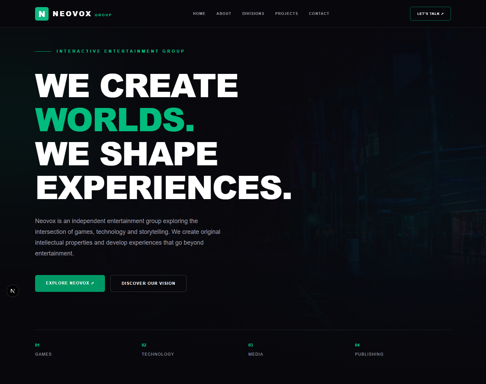
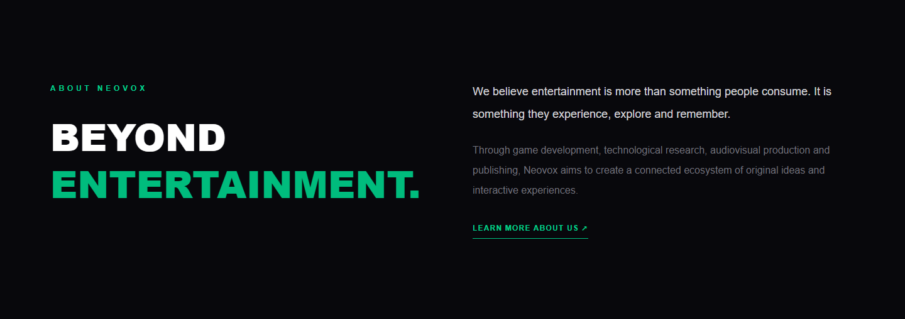
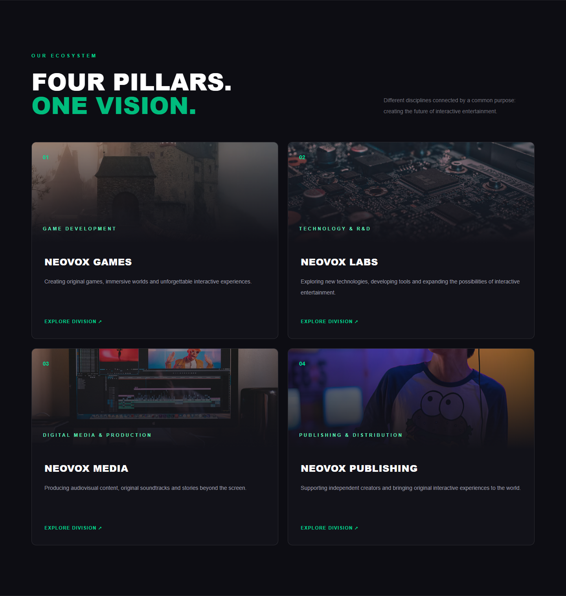
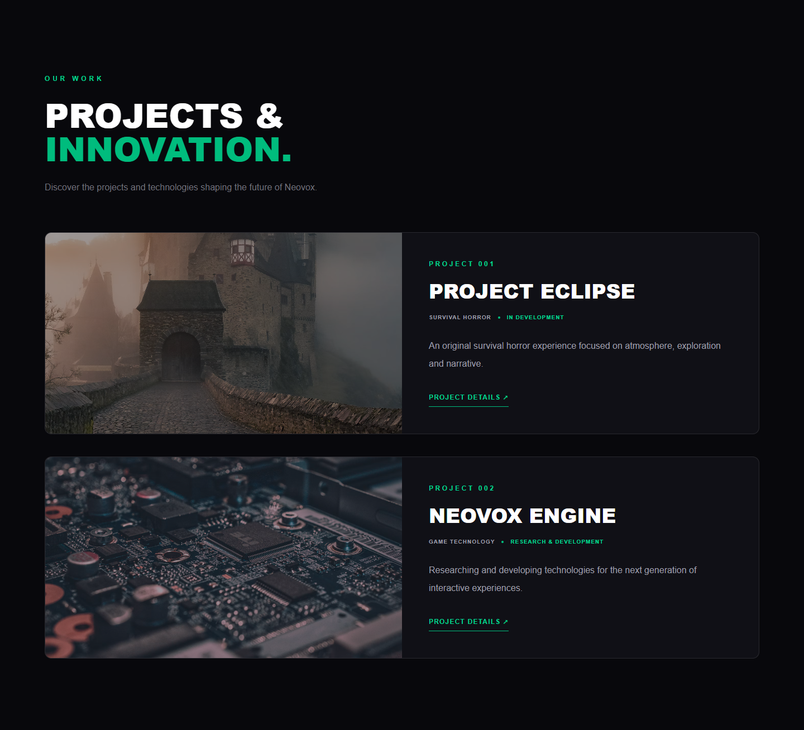
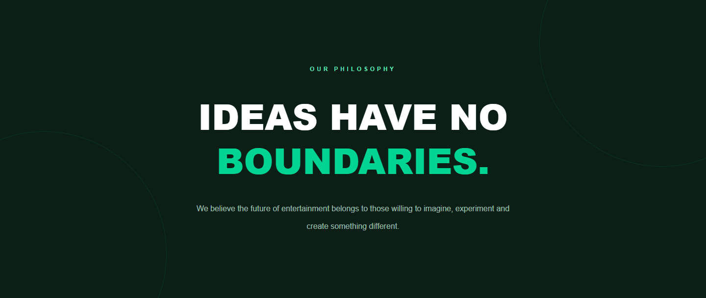
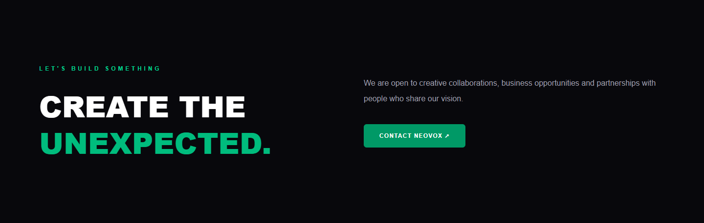
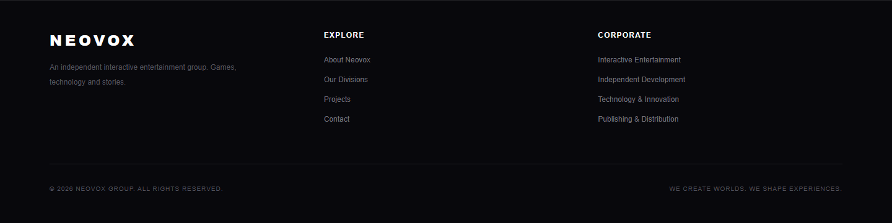
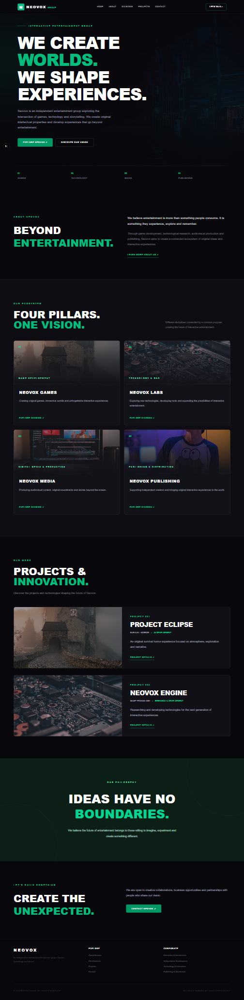
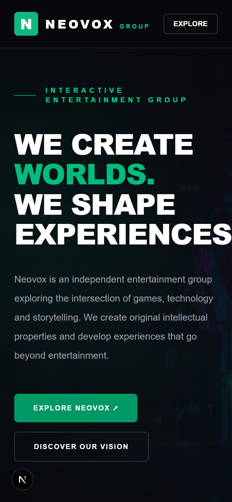

<div align="center">

# NEOVOX GROUP

**Site institucional de um grupo independente de entretenimento interativo.**
Games · Technology · Media · Publishing




</div>

---

## Sobre

A Neovox é um grupo independente que une **jogos, tecnologia e narrativa**.
Este repositório contém o site institucional do grupo: uma landing page de
página única, com interface escura e destaques em verde, que apresenta a
visão da empresa, suas quatro divisões e os projetos em andamento.

## Prévia

| Seção | Captura |
| --- | --- |
| **Sobre** |  |
| **Divisões** |  |
| **Projetos** |  |
| **Filosofia** |  |
| **Contato** |  |
| **Rodapé** |  |

<table>
  <tr>
    <th>Página inteira</th>
    <th>Mobile</th>
  </tr>
  <tr>
    <td></td>
    <td></td>
  </tr>
</table>

## Seções do site

| Seção | Componente | Conteúdo |
| --- | --- | --- |
| Header | `components/Header.tsx` | Marca, menu de navegação e botão de contato |
| Hero | `components/Hero.tsx` | Chamada principal e os quatro pilares do grupo |
| Sobre | `components/About.tsx` | Missão e visão da Neovox |
| Divisões | `components/Divisions.tsx` | Games, Labs, Media e Publishing |
| Projetos | `components/Projects.tsx` | Project Eclipse e Neovox Engine |
| Filosofia | `components/Philosophy.tsx` | "Ideas have no boundaries." |
| Contato | `components/Contact.tsx` | Parcerias e e-mail de contato |
| Rodapé | `components/Footer.tsx` | Links e informações corporativas |

## Tecnologias

- [Next.js 16](https://nextjs.org) (App Router + Turbopack)
- [React 19](https://react.dev)
- [TypeScript](https://www.typescriptlang.org)
- [Tailwind CSS 4](https://tailwindcss.com)

## Estrutura

```
neovox/
├── app/
│   ├── layout.tsx        # Layout raiz, fontes e metadados
│   ├── page.tsx          # Página inicial (monta as seções)
│   └── globals.css       # Estilos globais + Tailwind
├── components/           # Uma seção do site por arquivo
├── docs/screenshots/     # Capturas usadas neste README
├── public/               # Arquivos estáticos
└── scripts/
    └── screenshots.mjs   # Gera as capturas automaticamente
```

## Como rodar

Pré-requisito: [Node.js](https://nodejs.org) 20 ou superior.

```bash
# instalar as dependências
npm install

# servidor de desenvolvimento em http://localhost:3000
npm run dev
```

Outros comandos:

| Comando | O que faz |
| --- | --- |
| `npm run build` | Gera a versão de produção |
| `npm run start` | Roda a versão de produção |
| `npm run lint` | Verifica o código com ESLint |
| `npm run screenshots` | Atualiza as imagens de `docs/screenshots/` |

## Atualizando as capturas do README

Com o site rodando (`npm run dev`), abra outro terminal e rode:

```bash
npm run screenshots
```

O script usa o Edge ou o Chrome já instalado no computador, então não precisa
instalar nada. Ele captura cada seção em 1440 px de largura, a página inteira
reduzida e a versão mobile em 390 px. Para usar outro navegador ou endereço,
defina `BROWSER_PATH` ou `SITE_URL`.

## Identidade visual

| Uso | Cor | Tailwind |
| --- | --- | --- |
| Fundo principal | `#08080C` | `bg-[#08080C]` |
| Fundo das seções | `#0D0D13` / `#121219` | — |
| Destaque principal | `#10B981` | `emerald-500` |
| Destaque em textos | `#34D399` | `emerald-400` |
| Botões | `#059669` | `emerald-600` |
| Fundo da seção Filosofia | `#0B1F17` | — |

Para trocar a cor de destaque, substitua `emerald-` por outra cor do Tailwind
(por exemplo `sky-` ou `amber-`) nos arquivos de `components/`.

## Próximos passos

- [ ] Trocar o e-mail `contact@neovox.games` pelo endereço oficial
- [ ] Substituir as imagens do Unsplash por artes próprias dos projetos
- [ ] Usar `next/image` para otimizar o carregamento das imagens
- [ ] Menu mobile completo (hoje há só o botão "Explore")

---

<div align="center">

© 2026 NEOVOX GROUP. ALL RIGHTS RESERVED.
<br>
<sub>We create worlds. We shape experiences.</sub>

</div>
